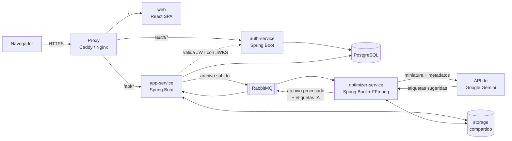

# Gestor Multimedia

Aplicación web para subir, organizar y previsualizar archivos multimedia (imágenes, audio, video y PDF). Los archivos se procesan en segundo plano para generar miniaturas y extraer metadatos, y se etiquetan automáticamente con IA (Google Gemini).
Esto cuando se despliegue en local
**Demo:** https://TU-DOMINIO <!-- reemplaza con el link real -->
**Cuenta demo:** usuario `TU-USUARIO` · contraseña `TU-CONTRASEÑA` <!-- la completa el autor -->

<!-- Agrega aquí 1 o 2 capturas de pantalla o un GIF del explorador: es lo primero que mira un reclutador. -->

## Funcionalidades

- Registro e inicio de sesión con JWT.
- Explorador de carpetas: crear, renombrar, mover y eliminar carpetas.
- Subida de archivos arrastrando y soltando, y eliminación de archivos.
- Procesamiento asíncrono: miniaturas de imágenes, portada de videos, vista previa de PDF y forma de onda de audio, más extracción de metadatos (dimensiones y EXIF, duración, bitrate, códecs, artista, autor, número de páginas).
- Previsualización: reproductor de audio con forma de onda, reproductor de video y visor de PDF.
- Etiquetas manuales y búsqueda de archivos con filtros por tipo, fecha, carpeta, etiquetas y metadatos.
- Etiquetado automático con IA usando la API de Gemini. Si la API no responde (sin key, cuota agotada, timeout), el archivo se procesa igual, solo que sin etiquetas automáticas.
- Modo demo: una tarea programada borra los archivos subidos después de un tiempo configurable, conservando los archivos de ejemplo.

## Arquitectura

Tres microservicios Spring Boot con arquitectura hexagonal (puertos y adaptadores), comunicados por HTTP y por mensajería asíncrona.



| Servicio | Responsabilidad |
| --- | --- |
| `auth-service` | Registro, login con bcrypt y emisión de JWT firmados con RSA. Publica sus llaves en `/.well-known/jwks.json`. |
| `app-service` | API principal: archivos, carpetas, etiquetas y búsqueda. Valida los JWT contra el JWKS de `auth-service` y guarda las etiquetas sugeridas por IA. |
| `optimizer-service` | Consume eventos de RabbitMQ, procesa cada archivo según su tipo (imagen, audio, video, documento) y le pide etiquetas a Gemini. |
| `web` | Frontend React servido por Nginx. |

### Decisiones de diseño

- **Arquitectura hexagonal:** el dominio no depende de Spring, la base de datos ni RabbitMQ. Cambiar el almacenamiento (por ejemplo, de disco a S3) solo requiere un adaptador nuevo.
- **Procesamiento asíncrono:** la subida responde de inmediato y el procesamiento pesado (FFmpeg) ocurre en otro servicio, que escala por separado.
- **JWT con RSA + JWKS:** `app-service` verifica tokens con la llave pública, sin compartir ningún secreto con `auth-service`.
- **Migraciones versionadas** con Flyway en cada servicio.

## Stack

- **Backend:** Java 21, Spring Boot (Web, Security, OAuth2 Resource Server, Data JPA, AMQP), Flyway
- **Procesamiento:** FFmpeg, Thumbnailator, Apache Tika, PDFBox, metadata-extractor
- **Frontend:** React, React Router, React Query, Zustand, Tailwind CSS, wavesurfer.js
- **Infraestructura:** PostgreSQL 16, RabbitMQ, Docker Compose, Nginx / Caddy
- **IA:** API de Google Gemini

## Cómo correrlo en local

Requisitos: Docker con Docker Compose.

```bash
cp .env.example .env    # completa las contraseñas y tu GEMINI_API_KEY
mkdir -p storage        # volumen compartido para los archivos
docker compose up --build
```

Luego levanta el proxy de la carpeta `nginx/` (ver comentarios en `nginx/docker-compose.yml`).

## Despliegue

Corre en una VM ARM de Oracle Cloud (capa gratuita) con el mismo `docker-compose.yml`, más `docker-compose.prod.yml`, que agrega Caddy con HTTPS automático, cierra los puertos internos y activa el modo demo:

```bash
docker compose -f docker-compose.yml -f docker-compose.prod.yml up -d --build
```

## Autor

Oscar David Mur Rodriguez — [LinkedIn](https://www.linkedin.com/in/oscar-mur-324689330/)
